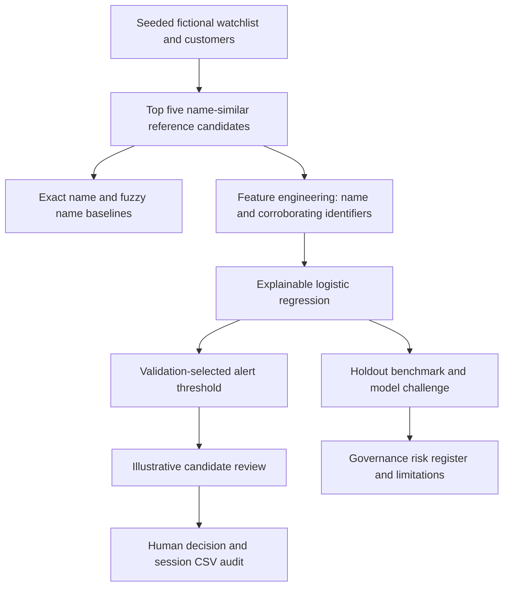

# Sanctions AI Governance Lab | Project 02

### Explainable sanctions candidate screening, identity resolution and accountable human review

> **Important** This is an educational demonstration using **90 fictional watchlist records and 900 fictional customers**. The watchlist is **NOT** the OFAC SDN List, a UN sanctions list, the UK Sanctions List or an actual government designation database. The names, regimes, identifiers and ground-truth labels are invented. **Never use this project to screen real people or businesses or make sanctions decisions.**

**Project author** Adiputera Saadon  
**Development transparency** The initial application, model pipeline and documentation were developed with AI coding and drafting assistance. The purpose is to understand and demonstrate AI governance through implementation, testing and documented limitations.

**Project 01:** [Financial Crime AI Governance Lab](https://github.com/Shinobi-Weapon-X/financial-crime-ai-governance-lab)  
**Project 02:** This separate sanctions screening portfolio demonstration

## Research premise

**How should a financial institution distinguish an automated possible name match from a substantiated identity match, without allowing opaque model scores to replace human judgment?**

This prototype compares three illustrative screening approaches. Its goal is to expose the trade-offs between detecting more synthetic matches, investigating avoidable false positives and accounting for conflicting identifiers.

## What is included

| Dashboard tab | What you can do |
|---|---|
| **Overview** | Compare exact names, fuzzy matching and explainable ML alert workloads |
| **Screen Identity** | Select a fictional customer, inspect five candidate reference matches, view names and identifiers, and inspect exact model-local log-odds contributions |
| **Validation** | Compare precision, recall, false positives, missed cases and a fixed threshold chosen using validation data |
| **Human Review** | Record a fictional analyst decision with rationale validation and export the session audit CSV |
| **AI Governance** | See a control-by-control evidence matrix, limitations, provenance manifest and official regulatory reference links |

## Synthetic experiment and results

The generator creates **900 fictional customer identities** and **90 fictional watchlist entries**, including **180 labelled synthetic identity links**. Each customer is paired with its five most name-similar fictional watchlist records, yielding **4,500 candidate pairs**.

Model type: StandardScaler plus class-weighted logistic regression trained on name, alias, entity type, birth year, country and identifier agreement/conflict features. Explanations show **mathematically additive contributions to the model's log-odds**. They do not establish identity, guilt or sanctions status.

A deterministic split assigns entire scenario-generating watchlist groups to training, validation and holdout partitions, containing **540 / 180 / 180 customers**. The model's alert threshold is selected once on validation data, then applied to the holdout. The fixed fuzzy threshold is 0.90, while exact matching requires literal equality.

| Holdout results (synthetic) | Exact name | Fuzzy name | Explainable ML |
|---|---:|---:|---:|
| Alerts | 49 | 84 | **38** |
| Precision | 59.2% | 42.9% | **86.8%** |
| Recall | 80.6% | 100.0% | **91.7%** |
| False positives | 20 | 48 | **5** |
| Missed synthetic identity links | 7 | 0 | **3** |

The ML threshold is **0.920**, selected on the validation set. The synthetic performance is artificially influenced by scenario design, fictional ID tokens and the use of intentionally correlated inputs. **These figures are not predictions of real sanctions-screening accuracy.** Exact/fuzzy baseline comparisons share the same synthetic holdout but are not independently threshold optimised; their alert workloads are different.

The benchmark's *customer-level positive* means an identity was pre-labelled as the same fictional watchlist record. It is **not a real sanctions designation**. Wrong-reference matches are separately counted in the evaluation JSON. Candidate retrieval can omit the correct reference; the model cannot recover a record absent from the candidate set.

## Run locally

Python **3.11 or 3.12** is recommended.

```bash
python -m venv .venv
# macOS/Linux
source .venv/bin/activate
# Windows PowerShell: .venv\Scripts\Activate.ps1
pip install -r requirements.txt
python -m scripts.build_assets
python -m pytest -q
streamlit run app.py
```

Open the localhost URL printed by Streamlit (usually `http://localhost:8501`). The generated data, classifier and evaluation files are already bundled, so the build command is optional for basic use; it is included to verify reproducibility. The bundled model was created using **scikit-learn 1.8.0**, which is pinned in `requirements.txt` for serialization compatibility. Do **not** load externally supplied `joblib` / pickle models.

## Deploy on Streamlit Community Cloud

1. Create a **new public GitHub repository**, e.g. `sanctions-ai-governance-lab`. Keep Project 01 separate.
2. Upload **the contents of this extracted folder** to the new repository root, preserving `app.py`, `requirements.txt`, `src/`, `data/`, `artifacts/`, `docs/`, `scripts/`, and `.streamlit/`.
3. Open [share.streamlit.io](https://share.streamlit.io/), select **Deploy a public app from GitHub**, enter your new repository, choose branch `main` and file `app.py`.
4. Select Python **3.12** if prompted. No API keys or Secrets are needed.
5. Test all five tabs, especially rationale rejection and CSV export; add the final live URL to this README and the repository's **About → Website** field.

See [START_HERE.md](START_HERE.md) for a beginner-friendly click-by-click guide.

## Technical architecture



## Repository files

| File / folder | Purpose |
|---|---|
| `app.py` | Streamlit application with five interactive tabs |
| `src/synthetic.py` | Reproducible fictional identities, regimes and risk scenarios |
| `src/matching.py` | Name normalisation, candidate retrieval, comparison features and explanations |
| `src/evaluation.py` | Group-disjoint partitions, model training, validation threshold and test evaluation |
| `src/governance.py` | Minimum evidence-rationale checks |
| `scripts/build_assets.py` | Reproduce CSVs, model file, metrics and source manifest |
| `data/` | Fictional watchlist and customer CSVs |
| `artifacts/` | Saved synthetic model, scored pairs, holdout metrics and source hashes |
| `tests/test_lab.py` | Automated checks of reproducibility, provenance, splits, explanations and outputs |
| `docs/MODEL_CARD.md` | Model intent, performance and limitations |
| `docs/RISK_REGISTER.md` | Governance and operational risks with mitigations |
| `docs/VALIDATION_REPORT.md` | Model challenge and methodological caveats |
| `docs/SOURCE_POLICY.md` | Official source references and synthetic-data provenance policy |
| `docs/FUNCTIONAL_TEST_CHECKLIST.md` | Five-tab manual end-user acceptance test |
| `docs/PROJECT_CASE_STUDY.pdf` | Shareable four-page portfolio case study |

## Governance scope and limitations

- **Demonstrated:** synthetic provenance with hashes, candidate explanations, model evaluation, identifier corroboration/conflict, human review rationale and session export.
- **Not demonstrated:** current official list ingestion, list freshness management, sanctions-regime applicability, ownership/control rules, ongoing monitoring, independent validation, fairness assessment, access control, durable case records or regulatory reporting.
- **No actual criminal activity or designated persons:** no real names or sanctions datasets are bundled or claimed.
- **Jurisdiction:** OFAC, UN and UK pages are included for *context only*. The current UK designations reference is the UK Sanctions List. The retired OFSI Consolidated List stopped being updated on 28 January 2026.
- **Regulatory framing:** MAS AI Risk Management Guidelines and NIST AI RMF provide governance reference points. This lab makes no certification or compliance claim.

## Official reference sources

- [OFAC Sanctions List Service](https://ofac.treasury.gov/sanctions-list-service)
- [UN Security Council Consolidated List](https://main.un.org/securitycouncil/en/sanctions/un-sc-consolidated-list)
- [UK Sanctions List](https://www.gov.uk/government/publications/the-uk-sanctions-list)
- [UK guidance on the 28 January 2026 list transition](https://www.gov.uk/guidance/moving-to-a-single-list-for-uk-sanctions-designations-28-january-2026)
- [MAS AI Risk Management Guidelines](https://www.mas.gov.sg/regulation/guidelines/guidelines-on-artificial-intelligence-risk-management-for-financial-institutions)
- [NIST AI Risk Management Framework](https://www.nist.gov/itl/ai-risk-management-framework)

## Publication and authorship

This is an educational portfolio deliverable produced with AI development and drafting assistance. Anyone reusing it should review the results, run the code themselves and avoid overstating personal coding contributions or regulatory effectiveness. Add a dated changelog of your independent tests and revisions when presenting it as your own ongoing body of work.

**License:** MIT, for the original demonstrator code. Official government publications, linked regulations and third-party libraries retain their own terms.
